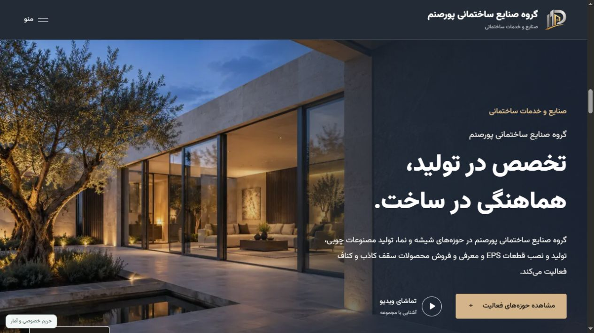
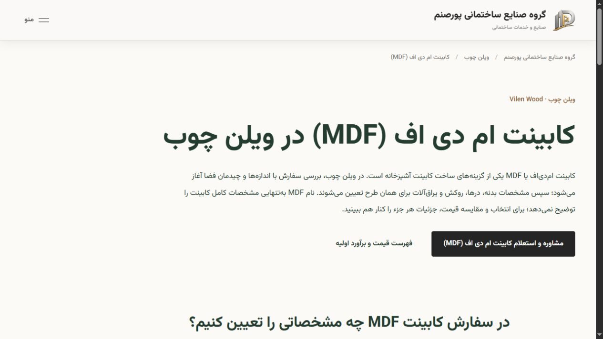
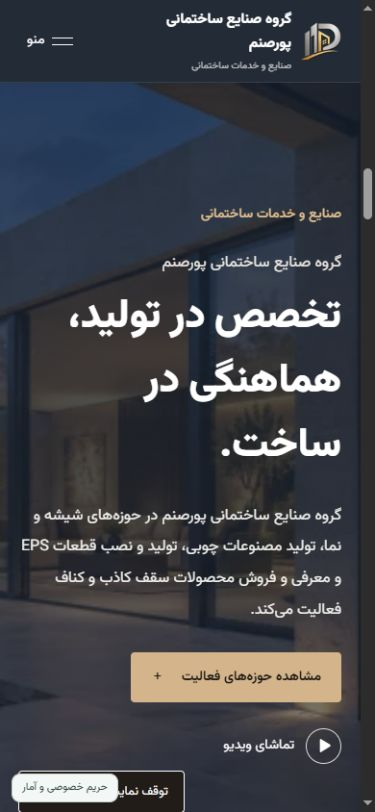

# پورصنم — وب‌سایت شرکتی و سامانه مدیریت محتوا

وب‌سایت فارسی و راست‌به‌چپ گروه صنایع ساختمانی پورصنم، با چهار بخش تخصصی و پنل مدیریت اختصاصی برای ویرایش و انتشار مستقل محتوا.

**[مشاهده سایت آنلاین](https://poursanamgroup.com/)** · **[English](README.md)**

## معرفی پروژه

این پروژه برای معرفی حوزه‌های فعالیت مجموعه، نمایش پروژه‌ها و رسانه‌ها، دریافت درخواست مشتریان و مدیریت محتوای سایت ساخته شده است. چهار بخش شیشه و پنجره، ویلن چوب، قطعات EPS نما و محصولات سقف، هویت اختصاصی خود را در ساختار مشترک سایت دارند.

## محدوده فعالیت فنی

- توسعه رابط کاربری واکنش‌گرا با چیدمان راست‌به‌چپ و تایپوگرافی فارسی.
- پیاده‌سازی API، اتصال به دیتابیس و پنل مدیریت محتوا.
- جداسازی پیش‌نویس از محتوای منتشرشده و انتشار مستقل بخش‌ها.
- مدیریت گالری، رسانه، مقاله، درخواست مشتری و ثبت‌نام کاربران.
- استقرار روی سرور لینوکسی، آماده‌سازی نسخه‌های به‌روزرسانی و ابزار بازیابی.
- پیاده‌سازی سئوی فنی و صفحات تخصصی خدمات.

## فناوری‌ها

| بخش         | فناوری                                |
| ----------- | ------------------------------------- |
| برنامه وب   | Next.js App Router و React            |
| زبان        | TypeScript                            |
| دیتابیس     | MongoDB                               |
| اعتبارسنجی  | قراردادهای داده و اعتبارسنجی سمت سرور |
| رابط کاربری | CSS Modules، اجزای مشترک و چیدمان RTL |
| استقرار     | Linux، Nginx، HTTPS و مدیریت سرویس    |

## امکانات منتخب

- صفحات مستقل چهار بخش با محتوای قابل مدیریت.
- ذخیره پیش‌نویس، انتشار مستقل و تاریخچه محتوا.
- گالری پروژه‌ها، آپلود تصویر و نمایش ویدیو.
- فهرست قیمت و برآورد اولیه کابینت و کمد در بخش چوب.
- فرم‌های درخواست مشتری و گردش کار مدیریت درخواست‌ها.
- صفحات خدمات با عنوان، توضیح، canonical و داده ساختاریافته مستقل.
- نقشه سایت پویا، کنترل ایندکس و محتوای قابل خواندن در HTML اولیه.

## چالش‌ها و تصمیم‌های فنی

محتوای مشترک سایت از محتوای هر بخش جدا شده است تا انتشار یک بخش، پیش‌نویس بخش‌های دیگر را منتشر نکند. اعتبارسنجی سمت سرور و بررسی تعارض ویرایش‌ها به حفظ قرارداد داده کمک می‌کنند. به‌روزرسانی برنامه نیز در نسخه‌ای جدا آماده می‌شود تا تعویض کد، داده‌های آنلاین شرکت را جایگزین نکند.

نسخه صفحات تخصصی چوب با بررسی TypeScript، lint محدود به تغییرات، بیلد production و ۴۱ بررسی یکپارچه سئو آزمایش شد. پس از نصب، دسترسی عمومی صفحات، متادیتا، لینک‌ها و نقشه سایت هم بررسی شدند. این شواهد، نتیجه همان نسخه را پوشش می‌دهند و ادعای ممیزی کامل امنیت یا تضمین رتبه گوگل نیستند.

نمای موبایل

  

## درباره این مخزن

این مخزن برای معرفی پروژه و نمایش تصاویر رابط عمومی سایت است. کد برنامه، دسترسی‌های مدیریت، جزئیات داخلی استقرار و اطلاعات کسب‌وکار در این مخزن منتشر نمی‌شوند. نگهداری سورس در مخزن خصوصی، مستقل از این معرفی عمومی انجام می‌شود.

تصاویر، نمای رابط وب‌سایت را مستند می‌کنند. نام و محتوای تجاری مجموعه متعلق به صاحبان مربوط است و این معرفی، مجوز استفاده از سورس خصوصی یا دارایی‌های برند محسوب نمی‌شود.
