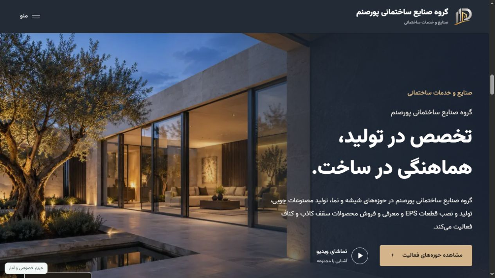
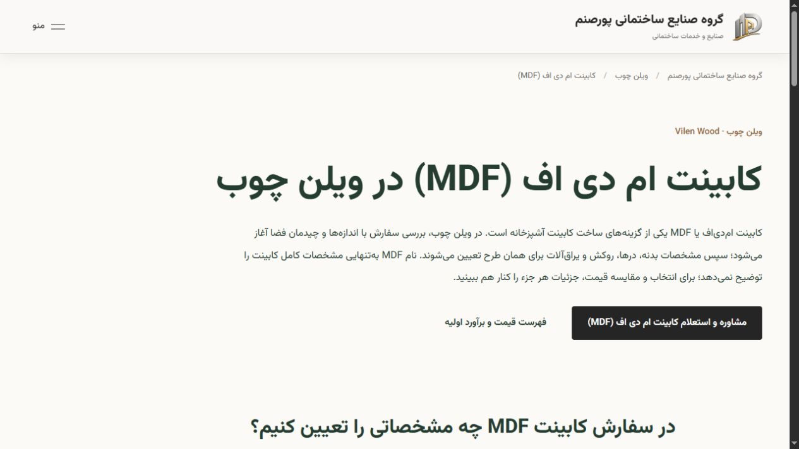
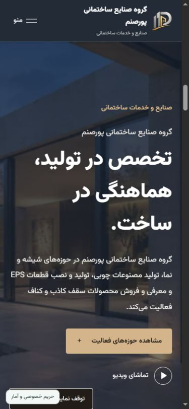

# Poursanam — Corporate Website & Management Platform

A Persian, right-to-left website and content management platform for Poursanam Industrial Group, connecting four business divisions through a shared corporate identity and independent content workflows.

**[Visit the live website](https://poursanamgroup.com/)** · **[توضیحات فارسی](README.fa.md)**

## Project at a glance

|          |                                                         |
| -------- | ------------------------------------------------------- |
| Type     | Corporate website with a custom administration platform |
| Language | Persian, with right-to-left layouts                     |
| Stack    | Next.js App Router, React, TypeScript, MongoDB          |
| Delivery | Responsive web interface and Linux server deployment    |
| Source   | Private; this repository is a portfolio case study      |

## The challenge

Present four distinct business divisions within one website while allowing staff to manage each division's content independently. The platform also needed project galleries, media publishing, customer inquiries, cabinet pricing and a deployment process that preserves live business data.

## Scope of work

- Responsive frontend development with Persian typography, right-to-left layouts and reusable interface components.
- Backend APIs, database integration and a custom content management panel.
- Independent draft and publishing workflows for departments, alongside shared site settings.
- Media upload and delivery, project galleries, articles, inquiries and customer registration workflows.
- Server deployment, versioned application updates, recovery tooling and technical SEO implementation.

## Selected features

### Four connected divisions

Dedicated pages for glass and windows, Vilen Wood, EPS facade products, and ceiling products. Each division has its own services, visual identity and content within the shared corporate site.

### A custom publishing workflow

Administrators can save drafts, publish department content separately and work with content history. Server-side validation and conflict checks help protect edits and published content.

### Media and project presentation

Responsive galleries, image uploads and video delivery support the company's public project and editorial content. Screenshots in this case study document the website interface.

### Cabinet pricing and inquiries

The wood division connects a published material-price catalog and estimate interface with service guides and a department-specific inquiry flow.

### Technical SEO

Server-rendered service pages, unique metadata, canonical URLs, structured data and a generated sitemap support search discovery. Dedicated wood pages explain MDF cabinets, high-gloss cabinets and wood products. Search rankings are evaluated separately from implementation.

## Engineering decisions

| Requirement                                      | Approach                                                               |
| ------------------------------------------------ | ---------------------------------------------------------------------- |
| Shared branding with separate department content | Shared layout and reusable components with department-specific content |
| Content editing without immediate publication    | Draft/published content separation and scoped publishing               |
| Consistent data contracts                        | TypeScript and schema validation at server boundaries                  |
| Search-friendly service content                  | Server-rendered HTML and individual page metadata                      |
| Updates without replacing live data              | Separate application releases with database-preserving installation    |
| Recovery confidence                              | Data-export verification and isolated restore checks                   |

## Delivery and verification

The application is deployed behind Nginx with HTTPS and managed as a system service. Updates build into separate releases and retain the previous release for application rollback.

The wood service-page release passed TypeScript checks, targeted linting, a production build and 41 SEO integration checks against an isolated database. Public HTTPS checks subsequently verified the new pages, their metadata, internal links and sitemap entries. These checks cover the selected release; they are not a claim of a complete security audit or guaranteed search placement.

Mobile interface

  

## Repository contents

This repository contains a project overview and screenshots of the public website. Application source, administrative access, internal deployment details and business records are not distributed here. The application source is maintained separately in a private repository.

Company branding and website content remain associated with their respective owners. This case study does not grant a license to the private application or the displayed brand assets.
